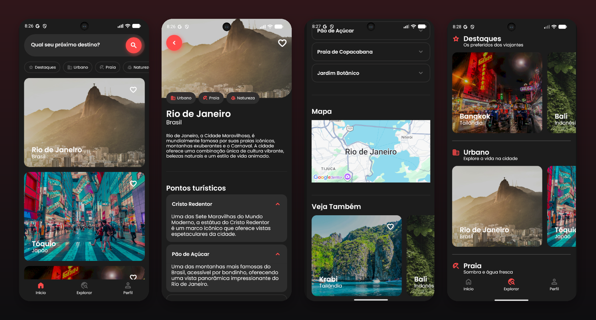
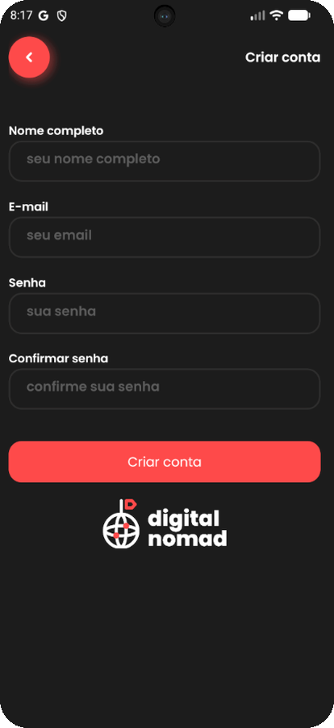
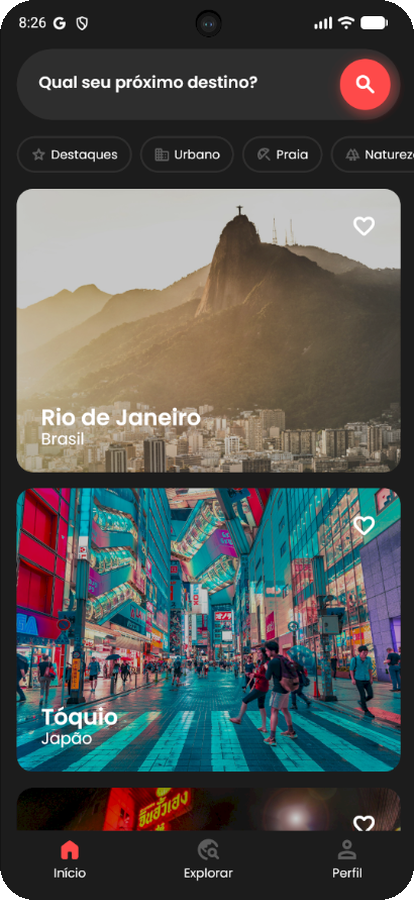
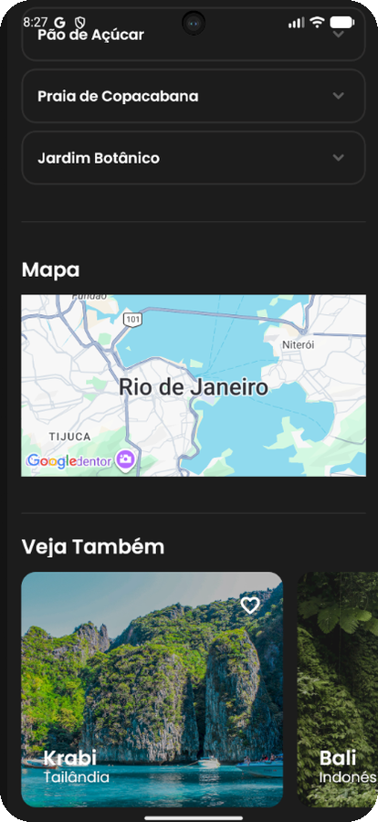
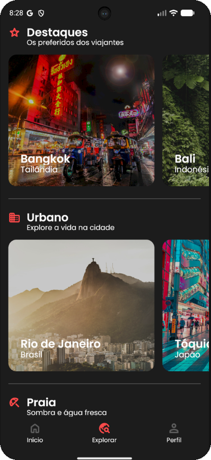
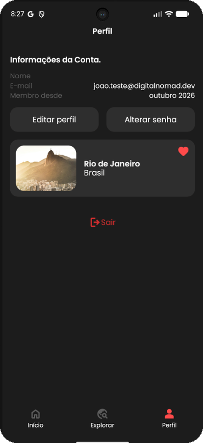
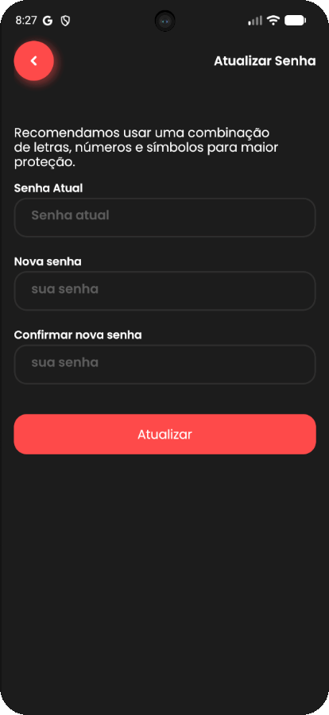

# Digital Nomad

App mobile (iOS e Android) que reúne cidades para nômades digitais: o usuário busca destinos, filtra por categoria, vê os detalhes de cada cidade e salva as favoritas.

> Projeto desenvolvido durante o curso de React Native da Coffstack (Lucas Garcez).

<p align="center">
  
</p>

## Telas

| Login | Criar conta | Início e busca | Detalhes da cidade |
|---|---|---|---|
|  |  |  |  |

| Mapa e "Veja também" | Explorar | Perfil e favoritos | Atualizar senha |
|---|---|---|---|
|  |  |  |  |

## Funcionalidades


- **Autenticação:** cadastro, login e recuperação de senha por e-mail.
- **Início:** busca de destinos e filtro por categoria (Destaques, Urbano, Praia, Natureza, Cultura, Shopping, História).
- **Busca:** resultados com a contagem de cidades encontradas.
- **Detalhes da cidade:** foto, categorias, descrição, pontos turísticos em accordion, mapa e sugestões de outras cidades ("Veja também").
- **Explorar:** cidades agrupadas por categoria em carrosséis horizontais.
- **Favoritos:** marcar cidades e vê-las no perfil.
- **Perfil:** dados da conta, edição de perfil, troca de senha e logout.
- **Atualizações OTA:** novas versões chegam pelo EAS Update, sem republicar nas lojas.

## Stack

| Camada | Tecnologias |
|---|---|
| Mobile | React Native 0.79, Expo SDK 53, Expo Router, TypeScript, Restyle (design system) |
| Dados e autenticação | Supabase (PostgreSQL, Auth, views SQL) |
| Formulários | React Hook Form + Zod |
| Build e deploy | EAS Build, EAS Update (OTA) |
| Debug | Reactotron |

## Arquitetura

O app segue a ideia de **ports & adapters**: as telas dependem de interfaces do domínio, nunca de uma implementação concreta.

- **Repositórios** (`auth`, `city`, `category`) definidos no domínio e injetados via Context (`RepositoryProvider`). Existem dois adapters: **Supabase** (produção) e **in-memory** (desenvolvimento sem backend), trocáveis sem mudar nenhuma tela.
- **Feedback ao usuário** também é uma interface (`IFeedbackService`), com adapters para Toast, Alert e Console.
- **Banco no Supabase** versionado em scripts SQL: tabelas, seeds e **views** (`cities_with_full_info`, `cities_with_categories`, `related_cities`) que entregam os dados já agregados para cada tela.

## Como rodar

Pré-requisitos: Node.js LTS e o app Expo Go no celular, ou um emulador Android/iOS.

```bash
git clone https://github.com/JoaoFabris/digital-nomad-app.git
cd digital-nomad-app
npm install
```

Crie um arquivo `.env` na raiz com as credenciais do seu projeto Supabase:

```env
EXPO_PUBLIC_SUPABASE_URL=https://seu-projeto.supabase.co
EXPO_PUBLIC_SUPABASE_ANON_KEY=sua_anon_key
EXPO_PUBLIC_SUPABASE_STORAGE_URL=https://seu-projeto.supabase.co/storage/v1/object/public
EXPO_PUBLIC_WEB_URL=https://seu-dominio   # link do e-mail de recuperação de senha
```

O banco é criado rodando, em ordem, os scripts de `src/infra/repositories/adapters/supabase/sql/` no SQL Editor do Supabase. Depois:

```bash
npx expo start
```

Depois, abra no Expo Go (QR code), no emulador Android (`a`) ou no simulador iOS (`i`).

## Estrutura

```
app/                  # telas e navegação (Expo Router)
docs/screenshots/     # imagens deste README
src/
├── domain/           # entidades e contratos (City, Category, Repositories)
├── infra/
│   ├── repositories/ # RepositoryProvider + adapters (supabase, inMemory)
│   │   └── adapters/supabase/sql/  # tabelas, seeds e views do banco
│   └── feedbackService/            # interface + adapters (Toast, Alert, Console)
├── data/             # hooks de dados (ex.: useCategories)
├── ui/               # componentes e tema
└── utils/
```

## Autor

João Fabris · [LinkedIn](https://www.linkedin.com/in/joaofabris) · [GitHub](https://github.com/JoaoFabris)
